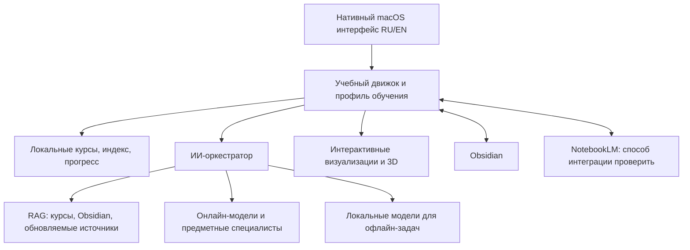

# ColiDev — объединённая macOS-платформа

Рабочий план объединения текущего ColiDev и расширенной идеи учебного ИИ-тьютора. Этот документ фиксирует требования, текущее состояние реализации, предложения и открытые решения. Начат отдельный нативный macOS-клиент в `macOS/ColiDev`; статус и ограничения ведутся в соответствующих категориях.

Копируемое задание на проектирование и разработку всего приложения собрано в [двуязычном промпте для разработчика](APP_BUILD_PROMPT.md); это бриф продукта, а не системная инструкция для поведения тьютора.

Краткий профиль опубликован в [README проекта](../README.md#project-profile), а подробное описание требований, отзывов и состояния прототипа — в [двуязычном профиле продукта](PRODUCT_PROFILE_RU_EN.md). Здесь хранится рабочий план.

The short profile is in the [project README](../README.md#project-profile); the [bilingual product profile](PRODUCT_PROFILE_RU_EN.md) records the full requirements, feedback, and prototype status. This folder contains the working plan.

Текущая готовность тестовой сборки и шаги ручной проверки собраны в [двуязычном отчёте прототипа](PROTOTYPE_READINESS_RU_EN.md). / Current build readiness and hands-on test steps are in the [bilingual prototype report](PROTOTYPE_READINESS_RU_EN.md).

Сверка полного согласованного объёма с кодом, CI и пользовательской проверкой на Mac находится в [двуязычном аудите готовности Cause & Corse / ColiDev](WHOLE_PROJECT_AUDIT_RU_EN.md). Это статус реализации, а не список функций, которые уже все готовы. / The full scope-to-code, CI, and user-reported Mac audit is in the [bilingual Cause & Corse / ColiDev readiness audit](WHOLE_PROJECT_AUDIT_RU_EN.md). It distinguishes implemented work from the remaining scope.

Передача проекта новому разработчику и Claude Code: [подробный handoff-аудит на русском](HANDOFF_TO_CLAUDE_CODE_RU_2026-10-23.md). Он фиксирует проверенный Git/CI-срез, устройство проекта, границы подтверждённых функций, нерешённые задачи и безопасный prompt для продолжения. Это срез 23.10.2026; после него репозиторий перенесён в `mirazizmamatkulov1-create/coli-dev`, CI исправлен, а актуальный статус и список ручной проверки на Mac ведутся в [отчёте о готовности](PROTOTYPE_READINESS_RU_EN.md). / That handoff is a 2026-10-23 snapshot; since then the repository moved to `mirazizmamatkulov1-create/coli-dev`, CI was fixed, and the current status and hands-on Mac checklist live in the [readiness report](PROTOTYPE_READINESS_RU_EN.md).

Обновлённый статус последнего CI-run, оценка Hermes/OpenCode/OpenClaw/Freebuff и последовательный личный маршрут обучения собраны в [плане текущей задачи и обучения RU/EN](CURRENT_TASK_AND_LEARNING_PATH_RU_EN.md). Проверка конкретных Stepik-курсов, научных и визуальных ресурсов собрана в [исследовании источников и агентных инструментов](research/learning-resources-and-agent-tools-audit-2026-10-18.md). / The latest CI status, Hermes/OpenCode/OpenClaw/Freebuff assessment, and sequential personal learning route are in the [current task and learning plan RU/EN](CURRENT_TASK_AND_LEARNING_PATH_RU_EN.md). The audit of selected Stepik courses, scientific/visual resources, and agent tools is in the [learning resources and agent tools research](research/learning-resources-and-agent-tools-audit-2026-10-18.md).

## Подтверждённое направление

Сделать один полноценный продукт для macOS, объединяющий обучение Python/backend из ColiDev с универсальной платформой для изучения всех важных направлений с самого начала. Приложение должно иметь русскую и английскую локализации. Нужны гибридные онлайн- и офлайн-режимы, RAG для актуальных данных, оркестрация ИИ-агентов, визуальные и интерактивные объяснения, включая 3D-сцены, интеграции с Obsidian и NotebookLM, а также тщательно спроектированный интерфейс по принципам Apple.

## Дальнейшее расширение продукта

После готового и проверенного релиза macOS добавить Windows-приложение с функциональным паритетом. Затем подготовить сайт продукта, откуда пользователи смогут скачивать установщики macOS и Windows; клонировать GitHub-репозиторий для установки им не понадобится. Конкретный Windows UI-стек, форматы установщиков, подпись и обновления предстоит выбрать.

## Важные ограничения плана

- XGENT — отдельный проект; его код, история и файлы не включать в ColiDev.
- С первого запуска доступны направления: математика, английский язык, физика, биология, зоология и программирование; список областей может расширяться. По каждому предмету и теме путь обучения идёт от базы к углублённым темам и специализациям через теорию, интерактивные тренажёры и практику; система даёт обратную связь и проверяет, что ученик сделал и понял. Зоология также связана с биологией. Русский и английский доступны в интерфейсе и обучении.
- Запрос на мощные модели с большими бесплатными лимитами — цель подбора, не гарантия: лимиты и доступность провайдеров меняются, нужны запасные маршруты и явный бюджет.
- Актуальность знаний должна обеспечиваться источниками, индексированием, датами обновления и цитированием, а не обещанием, что модель «всё знает».
- Поддерживаемые архитектуры прототипа: Intel Mac `x86_64` и Apple Silicon `arm64`; минимальная версия — macOS 13. CI проверил Intel на macOS 15, Apple Silicon — на macOS 15 и 26; физический запуск на Intel и на macOS 13/14 отдельно не подтверждён. / Supported prototype architectures: Intel Mac `x86_64` and Apple Silicon `arm64`; minimum macOS is 13. CI checked Intel on macOS 15 and Apple Silicon on macOS 15 and 26; physical Intel acceptance and macOS 13/14 have not been separately verified.
- Система обновлений добавлена в текущую ветку: каталог публичных GitHub Releases с датой и двуязычными заметками, скачивание архива под архитектуру этого Mac, постоянная история версий и место в настройках для Sparkle. Автоустановка намеренно не включается, пока приложение не получает валидный EdDSA public key и подписанный feed. Текущая beta неподписана и не нотарифицирована; в репозитории нет настроенных Actions secrets для Apple Developer ID и приватного ключа Sparkle. UI/API и сборка ждут CI, а установку и автообновление надо будет проверить на Mac после настройки ключей. / The current branch adds an update area: public GitHub Releases history with dates and bilingual notes, an architecture-matched download, and Sparkle controls in Settings. Automatic installation stays disabled until the app has a valid EdDSA public key and a signed feed. Current betas are unsigned and not notarized; the repository has no Actions secrets for Apple Developer ID or the Sparkle private key. The UI/API and build still need CI, and installation/automatic updates need Mac verification after keys are configured.

## Схема целевого продукта (черновик)

## Категории

- [01. Продукт и границы](categories/01-product.md)
- [02. Текущее состояние ColiDev](categories/02-current-state.md)
- [03. macOS-архитектура](categories/03-architecture.md)
- [04. ИИ, агенты и RAG](categories/04-ai.md)
- [05. Курсы и обучение](categories/05-learning.md)
- [06. Obsidian, NotebookLM, визуализации и 3D](categories/06-knowledge-and-media.md)
- [07. Безопасность, приватность и стоимость](categories/07-security-cost.md)
- [08. Этапы реализации](categories/08-roadmap.md)
- [09. Решения и открытые вопросы](categories/09-decisions.md)
- [10. Журнал обсуждений](categories/10-session-notes.md)
- [11. Обратная связь и критерии готовности](categories/11-feedback-and-acceptance.md)
- [12. Интерфейс и доступность / Interface and accessibility](categories/12-interface-and-accessibility.md)

## Правило ведения

Обновлять нужную категорию после обсуждений. Отмечать каждый пункт как **подтверждённое требование**, **факт из текущего кода**, **предложение**, **не проверено** или **открытый вопрос**. Архитектурные решения фиксировать после согласования; не выдавать планы за реализованные функции.

Структура уже покрывает документы непрерывности из мастер-промпта; отдельные дубли не создавать: [профиль продукта](PRODUCT_PROFILE_RU_EN.md) хранит видение, категории [02](categories/02-current-state.md), [08](categories/08-roadmap.md), [09](categories/09-decisions.md) и [10](categories/10-session-notes.md) — текущее состояние, дорожную карту, решения и журнал изменений соответственно, а [11](categories/11-feedback-and-acceptance.md) — задачи и критерии завершения.

**EN:** The existing structure already covers the continuity documents requested by the master prompt; do not create duplicate files. The [product profile](PRODUCT_PROFILE_RU_EN.md) records the vision; categories [02](categories/02-current-state.md), [08](categories/08-roadmap.md), [09](categories/09-decisions.md), and [10](categories/10-session-notes.md) record current status, roadmap, decisions, and change history; [11](categories/11-feedback-and-acceptance.md) records tasks and completion criteria.

Новый авторский текст на английском в README, профилях, плане, журнале и описаниях продукта сразу сопровождать полным переводом на русский. В учебных материалах для английского языка сами примеры оставлять на английском, но рядом давать полный перевод или пояснение по-русски. Названия API, моделей, файлов, команд и кода сохранять в исходном виде; переводить их механически нельзя.

